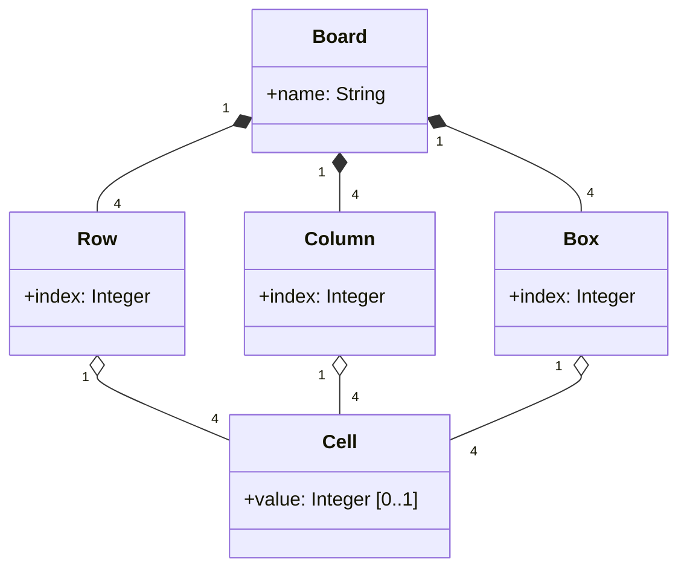

# Part I

## 1. Problem DSL

### 1.1 Concept List

| Concept | Intrinsic Properties | Extrinsic Properties |
|---------|---------------------|----------------------|
| Board   | name: String         | 4 rows, 4 columns, 4 boxes |
| Row     | index: Integer {0..3} | 4 cells |
| Column  | index: Integer {0..3} | 4 cells |
| Box     | index: Integer {0..3} | 4 cells |
| Cell    | value: Integer {1..4} [0..1] |  |

### 1.2 Metamodel

