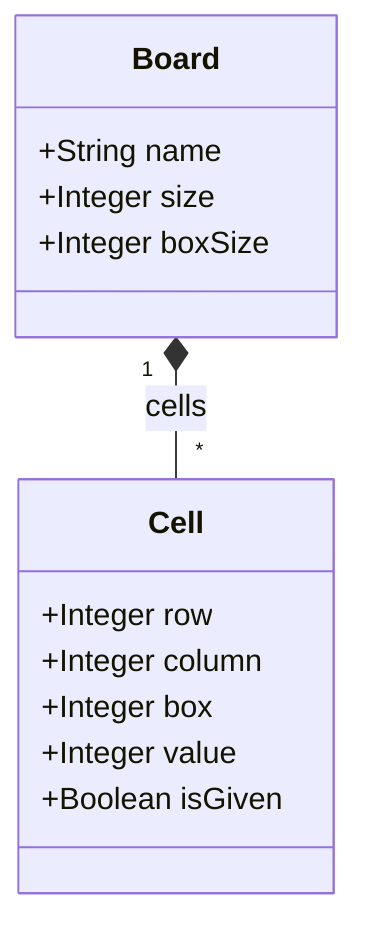

# Part I

This document presents the deliverables of the part I of the project

## 1. Problem DSL

### 1.1 Concept List

| Concept | Intrinsic Properties | Extrinsic Properties |
|---------|----------------------|----------------------|
| **Board** | `name`: String<br>`size`: Integer<br>`boxSize`: Integer | Contains `size × size` Cells<br>`size = boxSize²` |
| **Cell** | `row`: Integer {0..size-1}<br>`column`: Integer {0..size-1}<br>`box`: Integer {0..size-1}<br>`value`: Integer {1..size} [0..1]<br>`isGiven`: Boolean | Belongs to exactly one Board<br>`box` is derived from `row` and `column`<br>`isGiven` marks a fixed clue from the initial puzzle |

#### 1.1.1 Given and Empty Cells

In the Sudoku problem, some cells are initially filled while others are empty. These filled cells are clues for the problem resolution and differently from the other cells, their values may not be changed.

We chose to add a property `isGiven` to the `Cell` class in order to capture this concept and differentiate the types of cells, so that:

- a fixed clue: `value` is defined, `isGiven = true`, and the value belongs to `{1..size}`
- an empty cell: `value` is undefined and `isGiven = false`
- a filled but non-given cell: `value` is defined after solving, while `isGiven = false`

Or in other words:

- if `isGiven = true`, the value is part of the initial puzzle and must not be changed
- if `isGiven = false` and `value` is defined, the value was derived during solving
- if `value` is absent, the cell is still a valid board position but is currently unassigned

### 1.2 Metamodel

The following diagram displays a conceptual model, which was used as base to implement the besser metamodel given by `besser_sudoku_problem_metamodel.py`.



`value` is optional ([0..1]): a Cell without a value is an empty cell. `isGiven` is a Boolean flag that indicates whether the cell is a fixed clue from the original puzzle. Rows, columns and boxes are not entities of the metamodel; they are derived from the position of each Cell. Boxes are numbered row by row, left to right, top to bottom, starting at 0.

### 1.3 OCL Constraints

```ocl
context Board
inv BoxSizePositive: self.boxSize >= 1
inv SizeConsistent: self.size = self.boxSize * self.boxSize
inv CellCount: self.cells->size() = self.size * self.size
inv UniquePositions: self.cells->forAll(c1, c2 |
    c1 <> c2 implies (c1.row <> c2.row or c1.column <> c2.column))
inv ConsistentValues: self.cells->forAll(c1, c2 |
    (c1 <> c2
     and not c1.value.oclIsUndefined() and not c2.value.oclIsUndefined()
     and (c1.row = c2.row or c1.column = c2.column or c1.box = c2.box))
    implies c1.value <> c2.value)

context Cell
inv PositionValid: self.row >= 0 and self.row < self.board.size
                   and self.column >= 0 and self.column < self.board.size
inv BoxCoherent: self.box = (self.row div self.board.boxSize) * self.board.boxSize
                            + (self.column div self.board.boxSize)
inv GivenFlagValid: self.isGiven = true or self.isGiven = false
inv ValueValid: self.value.oclIsUndefined()
                or (self.value >= 1 and self.value <= self.board.size)
```

| Constraint | Rule it enforces |
|------------|------------------|
| `BoxSizePositive`, `SizeConsistent` | `size = boxSize²` |
| `CellCount`, `UniquePositions` | exactly one Cell per grid position |
| `ConsistentValues` | given values never repeat in a row, column or box |
| `PositionValid` | `row`, `column` in `{0..size-1}` |
| `BoxCoherent` | `box` agrees with `row` and `column` |
| `GivenFlagValid` | `isGiven` is a boolean marker for fixed puzzle clues |
| `ValueValid` | `value`, if present, in `{1..size}` |

## 1.4 Example Model for Problem Instance

A very simple valid problem instance is the 4x4 Sudoku board with `size = 4` and `boxSize = 2`. This board has 16 positions, grouped into 4 boxes of 2x2 cells.

A minimal example is:

| Row \ Column | 0 | 1 | 2 | 3 |
|--------------|---|---|---|---|
| 0 | 1 |  |  |  |
| 1 |  |  | 2 |  |
| 2 |  | 3 |  |  |
| 3 |  |  |  | 4 |

This corresponds to the following givens:

- `(0,0)` has value `1`
- `(1,2)` has value `2`
- `(2,1)` has value `3`
- `(3,3)` has value `4`

All other cells are empty, represented by an undefined `value`. The board is still valid because the given values are not repeated in the same row, column or 2x2 box, and the board respects the structural rules of the model.

This example is intentionally small: it is enough to show the semantics of the DSL without making the puzzle harder to read. The same idea scales to larger Sudoku boards and to the actual instances used in the assignment.

### 1.5 Validation of a Well-Formed Problem Instance

A problem instance is well formed if all Board and Cell constraints hold simultaneously:

1. `Board.size = Board.boxSize * Board.boxSize`
2. `Board.cells->size() = Board.size * Board.size`
3. no duplicate positions in the board
4. every cell is inside the valid row/column range
5. every computed `box` is consistent with the position of the cell
6. all filled values belong to the range `{1..size}`
7. two different non-empty cells that share a row, column, or box cannot contain the same value

These conditions ensure that the model describes a valid Sudoku board and not an arbitrary matrix of values. They are the base invariants used to detect invalid boards before any CNF encoding is produced.

### 1.7 Mapping to the Solution DSL

The problem DSL is the input to the solution DSL. The transformation from problem to solution is conceptually defined as follows:

- each `Cell` becomes a candidate assignment domain for values in `{1..size}`
- each valid assignment is represented as a logical variable in the CNF model
- each row, column and box restriction becomes one or more clauses
- each clause is a disjunction of literals, and each literal is a positive or negative variable reference
- the encoding table maps a cell/value assignment to a solver variable
- the solver configuration defines the strategy and execution parameters used to search for a valid model

This means the problem DSL provides the board structure and puzzle constraints, while the solution DSL translates them into a formula suitable for SAT/CNF and later for a quantum encoding or execution pipeline.

In other words, the board defines the domain of the problem, and the solution model defines how that domain is encoded as a satisfiability problem.

---