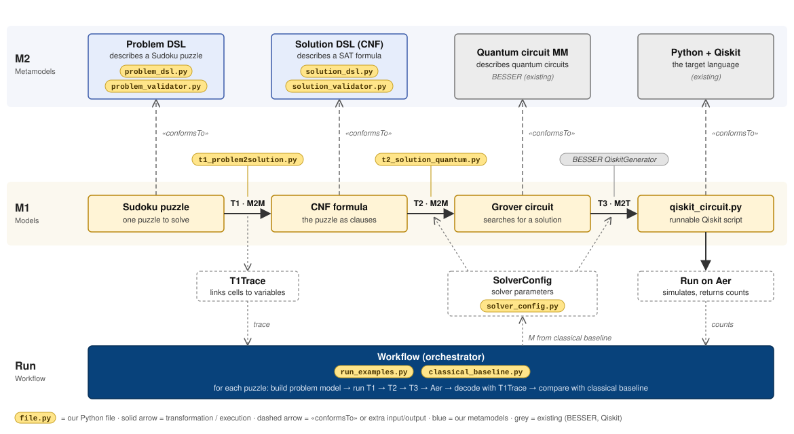

# Report Part 2 - Sudoku

**Curricular unit: TACS (Advanced Software Construction Techniques)**

**Students: Bruno Alves (up200907258), Gustavo Oliveira (up202502510), Nathália Couto (up202510623)**

**Date:**

## 1. Introduction

## 2. M2M Transformations

### 2.1 T1: Problem DSL → Solution DSL

### 2.2 T2: Solution DSL → Quantum DSL

## 3. M2T Transformation

### 3.1 T3: Quantum DSL → Qiskit

## 4. Workflow

## 5. Validation

## 6. Limitations

## References
